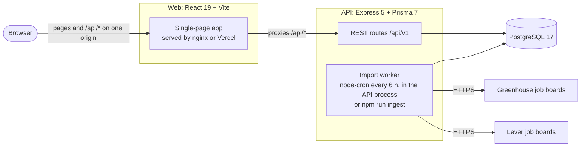

# Fredericton Grad Jobs

[](https://github.com/cabasoah/Fredericton-Grad-Jobs/actions/workflows/ci.yml)

A job board that imports real postings from company hiring pages and gives each job seeker a Kanban tracker and dashboard for their own applications.

<!-- After the first deploy (docs/DEPLOYING.md), replace this comment with:
**Live demo:** https://<your-project>.vercel.app

Demo accounts:
| Role | Email | Password |
| --- | --- | --- |
| Job seeker | <seeker email> | <password> |
| Employer | <employer email> | <password> |
-->

<!-- After recording the demo, replace this comment with:

-->

## Features

- **Real jobs:** postings from 11 companies' Greenhouse and Lever boards, imported on demand or every 6 hours (on in the deploy config); jobs that disappear from a board are closed, not deleted.
- **Search:** text search plus filters for job type, work arrangement, location, minimum salary and tags. Filters live in the URL, so a filtered view can be shared or bookmarked.
- **Employers:** register with a company, then post, edit and delete only their own jobs. Imported jobs are read-only.
- **Application tracker:** job seekers save jobs (or add ones found elsewhere) to a board with one column per stage, moved by mouse or keyboard. Moves show at once and roll back if the server refuses; every stage change is kept as history. Export to CSV.
- **Dashboard:** response rate, a funnel of how far applications got, and applications per week, each also available as a table.
- **Accounts and security:** session in an httpOnly cookie, role and ownership checks on the server, login and write rate limits, and 404 (not 403) for other users' data.
- **Delivery:** one-command Docker stack, and CI that runs lint, typecheck, unit, component and API tests, then Playwright against the composed app on every push.

## Architecture



The web app and API share Zod schemas from `packages/shared`, so both validate data with the same rules. The browser reaches the API through the web host (nginx locally, a Vercel rewrite when deployed), so the session cookie is first-party.

## Key decisions

- **PostgreSQL over a JSON file.** The tutorial's json-server had no constraints, relations or transactions; Postgres enforces unique keys and foreign keys and writes a stage change and its history row together.
  Trade-off: a database to run and migrations to manage, handled by Docker and Prisma.
- **JWT in an httpOnly cookie, not localStorage.** Page scripts cannot read the token, so an injected script cannot steal it, and SameSite=Lax keeps other sites from using it in POST requests.
  Trade-off: the API must be on the same site as the app, so the web host proxies `/api/`.
- **Cursor pagination, not offsets.** Each page asks for rows after the last (sort value, id) it saw, so new jobs never shift pages into skipped or repeated rows, including sorts where salaries are missing.
  Trade-off: no "jump to page 7", only Load more.
- **Upsert on (source, posting id) for imports.** A unique index on the posting's source and its ATS id makes every import idempotent; postings that vanish are closed, and nothing is closed if a download fails.
  Trade-off: a posting republished under a new ATS id appears as a new job.
- **No refresh tokens.** One signed token with a 1-hour lifetime keeps the server stateless and the code small.
  Trade-off: a token cannot be revoked before it expires, and users sign in again every hour.

## Numbers

| Measure             | Result                                                                                                        | Source                                                                                                   |
| ------------------- | ------------------------------------------------------------------------------------------------------------- | -------------------------------------------------------------------------------------------------------- |
| Jobs imported       | 799 jobs from the first import of 11 configured companies (8 had openings); a second run created 0 duplicates | `IngestRun` table, 26 Oct 2026                                                                           |
| Tests               | 147 unit and component (api 70, web 63, shared 14), 55 API integration, 3 Playwright flows; all passing       | `npm test`, `npm run test:integration`, `npm run test:e2e`, 27 Oct 2026                                  |
| Line coverage       | API 90.29% (unit + integration), web 62.15%; v8, every source file included                                   | `npm run coverage`, 27 Oct 2026                                                                          |
| Lighthouse (mobile) | `/`: performance 73, accessibility 98, best practices 96, SEO 83. `/jobs`: 67, 98, 96, 83                     | Lighthouse 13.5.0, default mobile settings, median of 3 runs against the local Docker stack, 27 Oct 2026 |
| JS bundle           | Main 542.41 kB (gzip 171.39 kB); tracker 57.95 kB and dashboard 371.69 kB load only when opened               | `vite build`, 27 Oct 2026                                                                                |

## Run locally

With Docker only:

```bash
docker compose up --build
```

Open http://localhost:8080. The first start migrates the database and loads sample jobs and demo employer accounts (password `demo-password-123`).

Without Docker for the app (Node.js and npm; Docker for PostgreSQL only):

```bash
npm install
cp apps/api/.env.example apps/api/.env
docker compose up -d db
npm run db:migrate
npm run db:seed
npm run dev        # web on http://localhost:3000, API on http://localhost:4000
```

More: [development and tests](docs/DEVELOPMENT.md), [API reference](docs/API.md), [deploying](docs/DEPLOYING.md), [case study: the hardest bug](docs/CASE_STUDY.md).

## What I would do next

1. Split the remaining pages into separately loaded chunks to bring the main bundle under 500 kB and lift the mobile performance scores.
2. Password reset and email verification.
3. Reminders for the follow-up dates the tracker already stores.

## How this was built
Developed with AI assistance. Claude (Anthropic) wrote and reviewed much of the code. I directed the project, ran and checked every result.